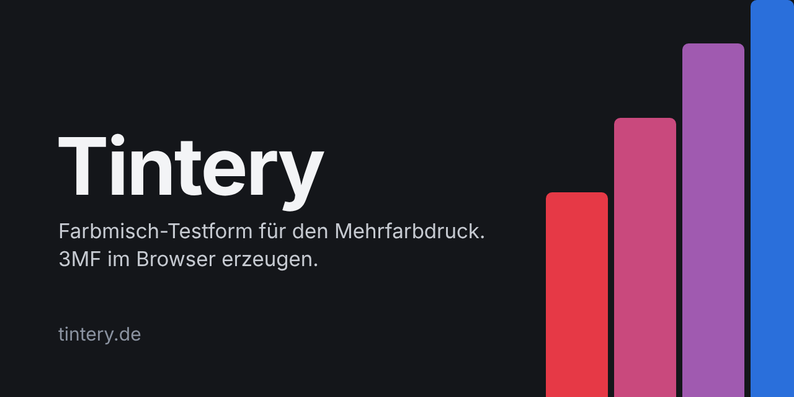
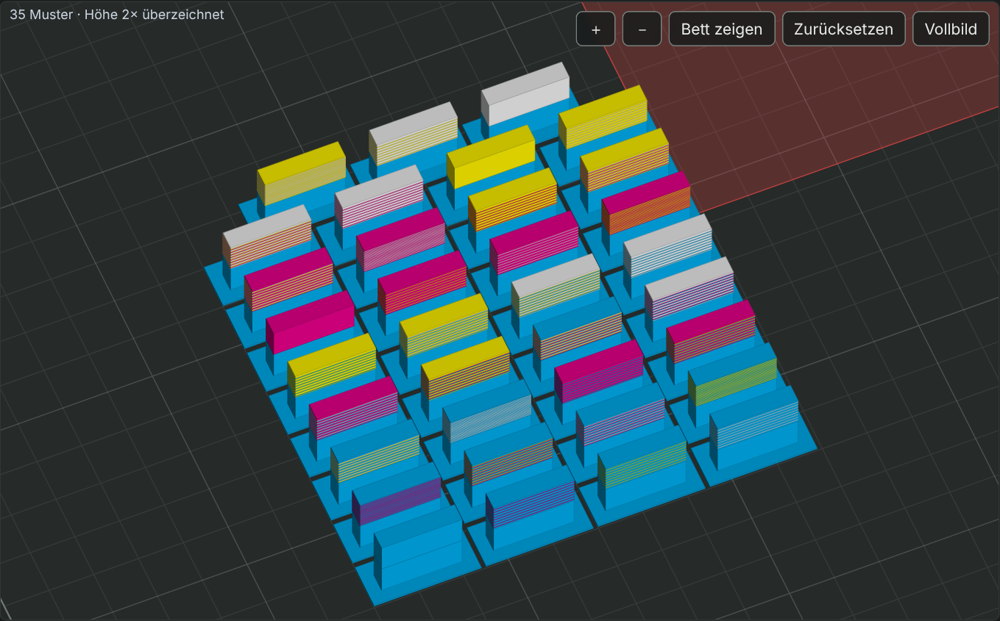
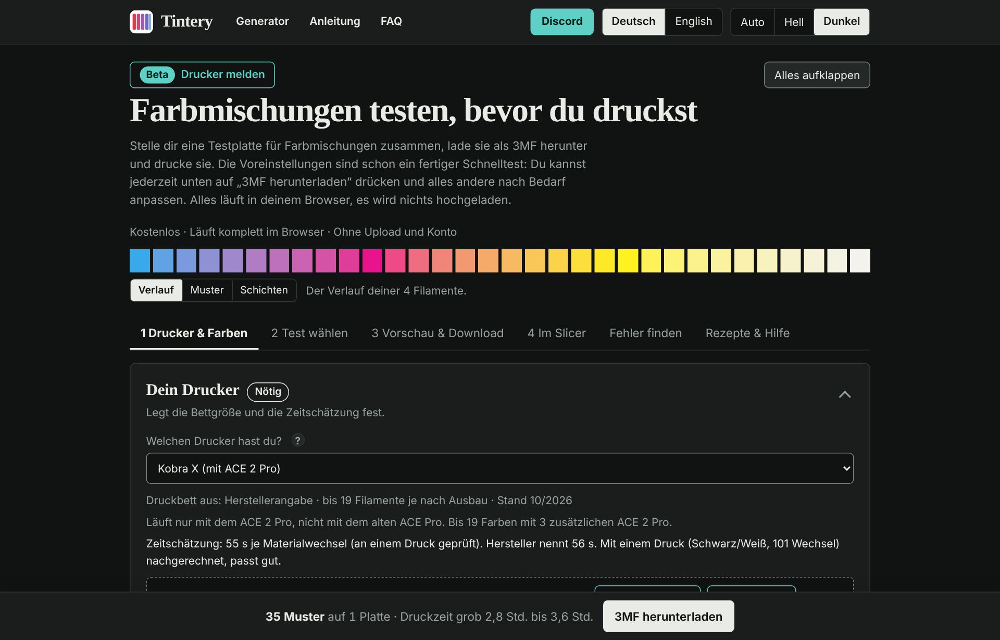
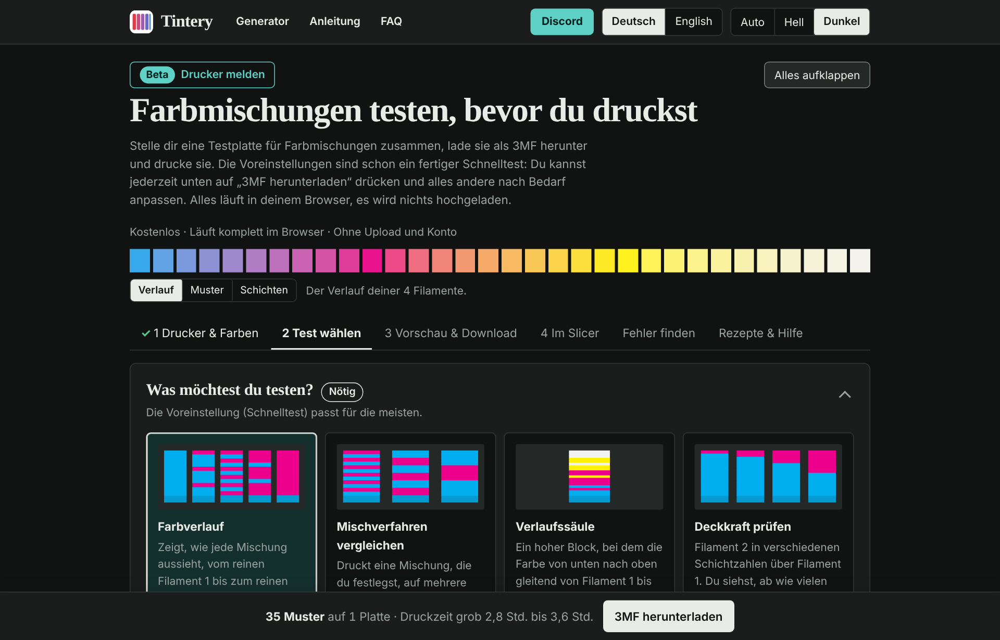
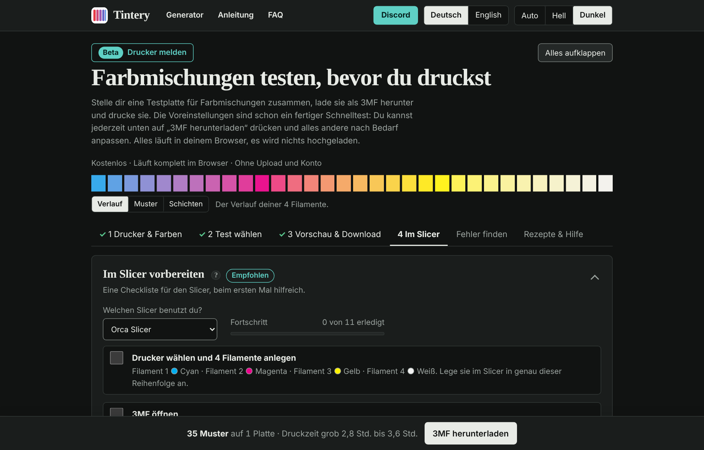
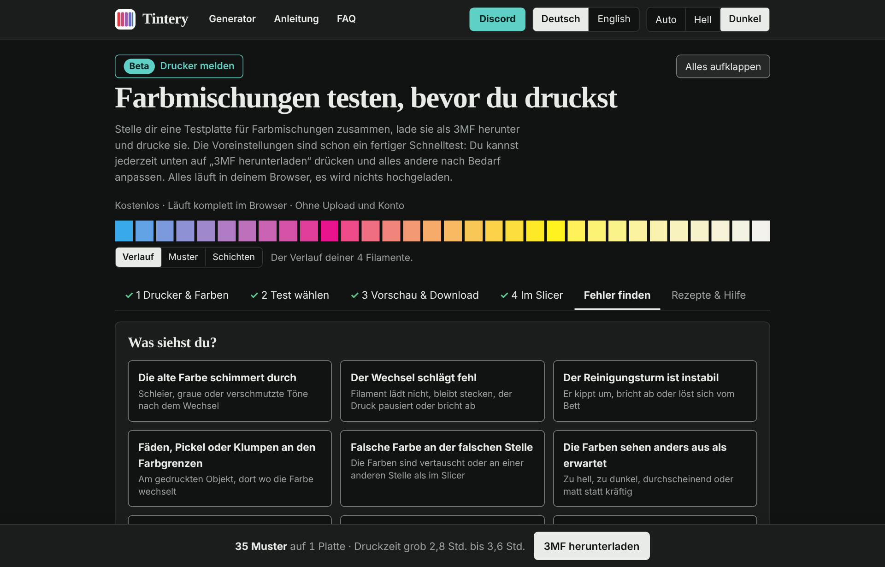
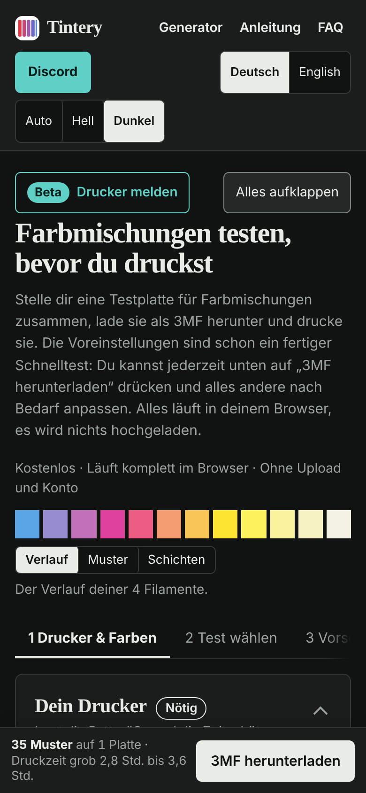

# Tintery

**Teste Farbmischungen, bevor du druckst.**
Tintery erzeugt im Browser eine 3MF-Testplatte für den Mehrfarb-3D-Druck.
Kostenlos · ohne Konto · ohne Upload

[**🌐 tintery.de**](https://tintery.de) &nbsp;·&nbsp; [**💬 Discord**](https://discord.gg/VZBjRtJq4) &nbsp;·&nbsp; [English](#english)

 

 

## ✨ Was ist Tintery?

Mischfarben beim Mehrfarbdruck entstehen durch dünne, abwechselnde Schichten. Wie das Ergebnis aussieht, hängt von Filament, Schichthöhe und Verfahren ab und lässt sich am Bildschirm nur grob vorhersagen.

Tintery baut dir eine **Platte mit Farbmustern in vielen Mischverhältnissen**. Du druckst sie einmal und siehst, was deine Filamente wirklich ergeben.

## 🧰 Funktionen

| | |
|---|---|
| 🎨 **Testplatte als 3MF** | Farbverlauf, Mischverfahren vergleichen, Verlaufssäule, Deckkraft prüfen, Schichthöhen vergleichen |
| 👀 **Mischvorschau und 3D-Ansicht** | Zeigt vorab, was entstehen kann. Bedienung wie im Slicer. Das ist eine Näherung am Bildschirm |
| 🎯 **Wunschfarbe** | Zielfarbe eingeben, Tintery sucht die passende Mischung |
| ✅ **Slicer-Checkliste** | Abhakbar, für Orca Slicer, Bambu Studio, Anycubic Slicer Next und PrusaSlicer |
| 🔧 **Fehlerdiagnose** | Symptom wählen, Ursachen mit Prüfung und Lösung |
| 🖨️ **Über 25 Drucker** | Bettmaße, Wechselzeiten, dazu Zeit- und Kostenschätzung |
| 🌗 **Deutsch und Englisch** | Hell und Dunkel, auch auf dem Handy |

## 🖼️ So sieht es aus

<table>
  <tr>
    <td width="50%"> <b>1 · Drucker und Farben</b>, mit sofortiger Mischvorschau</td>
    <td width="50%"> <b>2 · Test wählen</b>, der Schnelltest ist vorausgewählt</td>
  </tr>
  <tr>
    <td width="50%"> <b>4 · Im Slicer</b>, Checkliste zum Abhaken</td>
    <td width="50%"> <b>Fehler finden</b>, Ursachen nach Wahrscheinlichkeit</td>
  </tr>
</table>

 
Auch auf dem Handy bedienbar

## 🔒 Datenschutz

- Der Generator läuft **komplett lokal im Browser**. Er sendet nichts, setzt keine Cookies und lädt keine externen Schriften, Skripte oder Tracker.
- Nur wenn du selbst das **Kontaktformular** oder **„An Tintery senden“** benutzt und zustimmst, geht deine Nachricht per E-Mail an den Betreiber.
- Mehr steht in der [Datenschutzerklärung](https://tintery.de/datenschutz.html) auf tintery.de.

## 🧪 Ehrlich zum Stand

Was getestet ist und was nicht

- Getestet nur in **Chromium**. Safari und Firefox sind nicht geprüft.
- Die englische Version ist nicht von einem Muttersprachler geprüft.
- Die Mischvorschau rechnet linear und **ersetzt keinen Testdruck**.
- Mit PrusaSlicer wurde die Datei geöffnet, aber noch nicht gedruckt.
- Die Zeit- und Kostenwerte sind grobe Schätzungen. Dein Slicer rechnet genauer.

## 🤝 Mitmachen

Fehler, Wünsche und fehlende Drucker kannst du als **Issue**, im [Discord](https://discord.gg/VZBjRtJq4) oder über das [Kontaktformular](https://tintery.de/kontakt.html) melden.

## 📄 Lizenz

**Alle Rechte vorbehalten.** Der Quelltext ist nur zur Ansicht öffentlich. Kopieren, Ändern, Veröffentlichen und Weitergeben sind ohne schriftliche Erlaubnis nicht gestattet, siehe [LICENSE](LICENSE). Anfragen: info@tintery.de

 

---

<h2 id="english">🇬🇧 English</h2>

**Tintery** builds a **3MF test plate for colour mixing** in multicolour 3D printing, right in your browser. Print it once and see how your filaments really mix. Free, no account, no upload.

- **Website:** [tintery.de](https://tintery.de) (add `?lang=en` for English) · **Discord:** [join](https://discord.gg/VZBjRtJq4)
- **Privacy:** the generator runs locally and sends nothing. Only if you use the contact form and agree, your message is emailed to the operator.
- **Status:** tested in Chromium only. The English text has not been checked by a native speaker. The mix preview is an approximation, not a replacement for a test print.
- **Licence:** all rights reserved. The source is public for viewing only. Copying, modifying, publishing or redistributing without written permission is not allowed, see [LICENSE](LICENSE).
